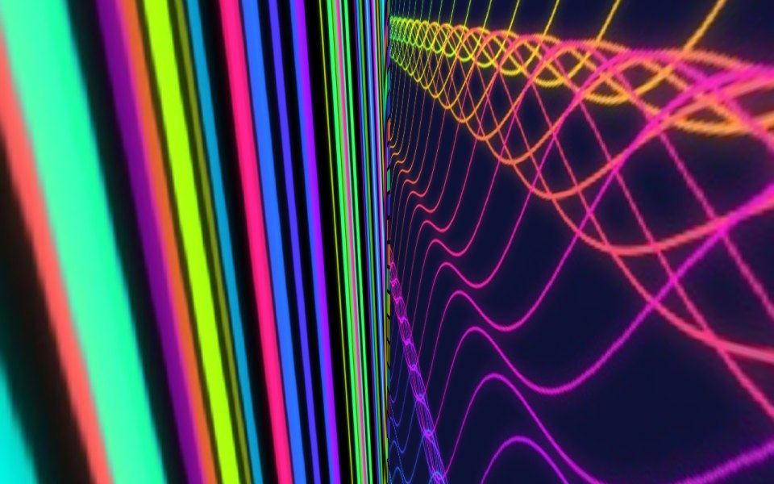
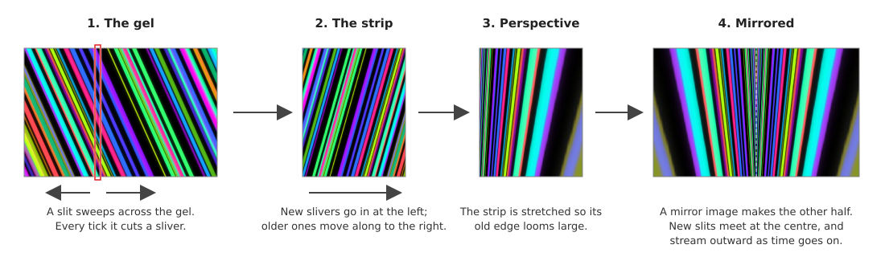
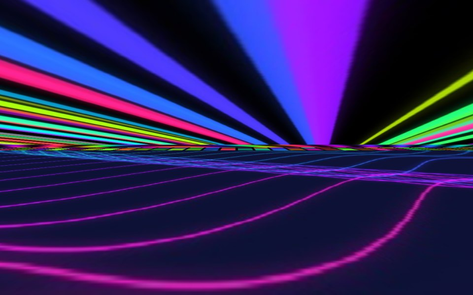
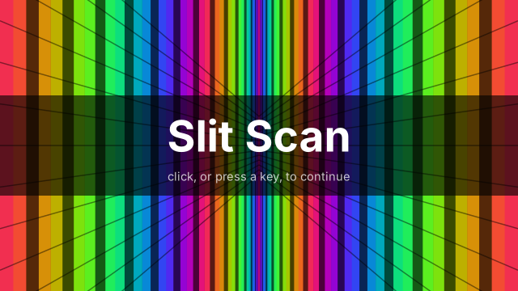
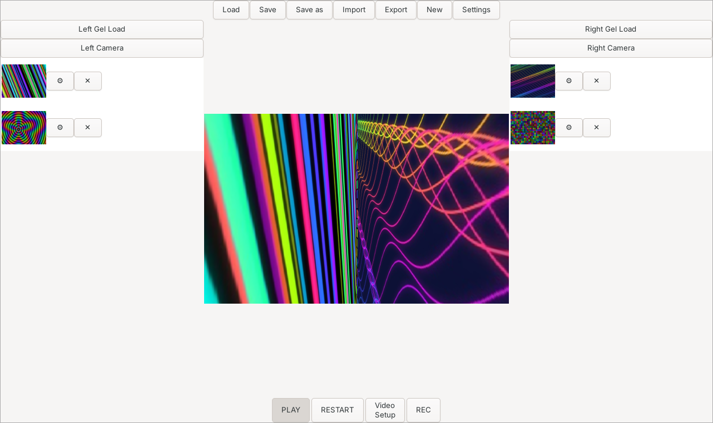
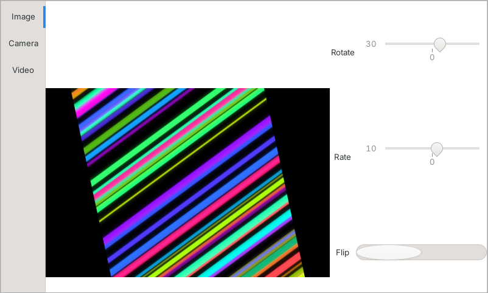
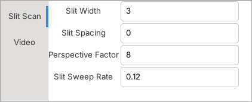
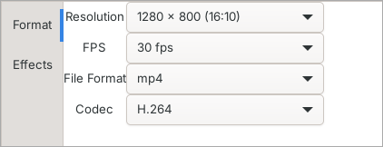
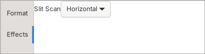

#+TITLE: Slit Scan
#+OPTIONS: toc:2 num:nil

* Introduction

Slit Scan makes moving slit-scan images: the streaming tunnels of
light made famous by the Stargate sequence in /2001: A Space
Odyssey/, and later by the title sequences of /Doctor Who/.

In 1968 Douglas Trumbull made the Stargate with a camera, a
motorised rig and a narrow slit, exposing one frame at a time over
long minutes. Slit Scan does the same thing digitally and live. You
give it pictures, which it calls /gels/, and it pulls a thin slit across them, frame after frame, and
builds those slivers into a picture that streams out of the centre
of the screen towards you.

Gels can be still images, videos, or a live camera. You can watch
the result as it is made, record it to a video file, save the whole
setup to come back to later, and share it, gels and all, with
someone else.

What it is for:

+ /Music visuals/: footage for music videos, live sets and VJ
  performances.
+ /Title sequences and motion graphics/: openings, transitions and
  backgrounds with that hand-made 1960s look.
+ /Experimenting/: feed it anything, a painting, a texture, your own
  face on a webcam, and see what comes out.

** Platform support

Slit Scan is currently supported on *Linux*. Support for *macOS* and
*Windows* is forthcoming.

* Contents
- [[#how-a-slit-scan-is-made][How a slit scan is made]]
- [[#features][Features]]
- [[#installing][Installing]]
- [[#building][Building]]
- [[#using-slit-scan][Using Slit Scan]]
- [[#setups-saving-and-sharing][Setups: saving and sharing]]
- [[#for-developers][For developers]]
- [[#roadmap][Roadmap]]
- [[#credits-copyright-license][Credits, Copyright, License]]

* How a slit scan is made

1. *The gel.* A narrow slit sweeps slowly across the gel. Every tick
   (30 times a second, or whatever frame rate you choose), the slit
   cuts a thin sliver from the gel.
2. *The strip.* Each new sliver goes in at the left edge of a strip,
   and everything already there moves along to the right. The strip
   is a record of what the slit has seen over time, newest first.
3. *Perspective.* The strip is stretched so that its newest edge
   stays its own height while its oldest edge becomes many times
   taller (the /perspective factor/). Old slivers loom towards you.
4. *Mirrored.* A mirror image of that makes the other half. The two
   halves meet in the middle, where the newest slivers appear, and
   the picture streams outwards from there as time goes on.

With gels on both sides, each half has its own gel. The *horizontal*
slit scan is the same thing turned on its side: the halves are the
top and the bottom, and they meet along a line across the middle.

/A horizontal slit scan: the top half from one gel, the bottom half
from another./

* Features

+ *Vertical and horizontal slit scans*, switchable while playing.
+ *Three kinds of gel*: still images (JPEG, PNG, GIF, WebP), videos
  (anything FFmpeg can read) and a live camera.
+ *Any number of gels on each side*, taking turns in order and
  starting over at the top. Drag them to reorder them, or across to
  the other side; remove them with a click.
+ *Per-gel rotation, spin and flip*, with a live, spinning preview.
+ *Smooth, anti-aliased output*: the slit and the perspective are
  filtered, so fine detail streams without jaggies or shimmer.
+ *Live control*: slit width, spacing, perspective and sweep speed
  take effect while the scan is playing.
+ *Recording* to MP4, MKV, MOV, WebM, AVI or Ogg, in H.264, H.265,
  VP9 or AV1, at resolutions up to 7680 × 4320.
+ *Setups* saved as plain, readable YAML files.
+ *Sharing*: export a setup and all its gels as one =.hal= file, and
  import someone else's with one click.
+ *Plays well with tiling window managers*: dialogs are made to float
  under Hyprland, Sway and the like.

* Installing

** Arch Linux (AUR)

#+begin_src shell
aura -A slit-scan-git
#+end_src

Or with any other AUR helper, or by hand with =makepkg=.

** Flatpak

Until Slit Scan is on Flathub, build the Flatpak from the source (see
[[file:packaging/README.org][packaging/README.org]]):

#+begin_src shell
flatpak-builder --user --install --force-clean build-flatpak packaging/flatpak/de.atomlogik.SlitScan.yml
flatpak run de.atomlogik.SlitScan
#+end_src

The Flatpak carries its own FFmpeg, with all four recording formats.

* Building

** Requirements

| What                | Needed for                           |
|---------------------+--------------------------------------|
| A C++23 compiler    | building (Clang, or GCC 14 or newer) |
| CMake 3.28 or newer | building                             |
| Ninja (or Make)     | building                             |
| gtkmm 4             | the user interface                   |
| OpenCV 4 or 5       | images, videos, cameras              |
| yaml-cpp            | setup files                          |
| libzip              | sharing setups (=.hal= files)          |
| FreeType, GLib      | text, resources                      |
| FFmpeg              | recording (strongly recommended)     |
| Cambalache          | only for changing the UI design      |

On Arch Linux:

#+begin_src shell
sudo pacman -S clang cmake ninja gtkmm-4.0 opencv yaml-cpp libzip ffmpeg
#+end_src

Other distributions have the same libraries under their own package
names, usually with =-dev= or =-devel= on the end.

FFmpeg is used at run time, not when building. Without it Slit Scan
still records, through OpenCV's own video writer, but with fewer
codecs and no control over encoding speed (see [[#recording][Recording]]).

** Build and run

#+begin_src shell
cmake -S . -B build -GNinja -DCMAKE_EXPORT_COMPILE_COMMANDS=ON
ninja -C build
./build/main/slitscan
#+end_src

The compiler is CMake's default; add =-DCMAKE_CXX_COMPILER=clang++=
for Clang. Without =CMAKE_BUILD_TYPE= the build is a Debug build.

| Option                       | Default | What it does                                    |
|------------------------------+---------+-------------------------------------------------|
| =-DENABLE_PLAYGROUND=OFF=      | =ON=      | Leaves out the experiments in =playground/=       |
| =-DSLITSCAN_REGENERATE_UI=OFF= | =ON=      | Never runs Cambalache; uses the committed files |
| =-DCAMBALACHE=/path/to/it=     |         | Where Cambalache is, if not the Flatpak         |

To install system-wide (the program, its desktop entry, AppStream
metadata and icon):

#+begin_src shell
cmake -S . -B build -GNinja -DCMAKE_BUILD_TYPE=Release -DCMAKE_INSTALL_PREFIX=/usr -DENABLE_PLAYGROUND=OFF
ninja -C build
sudo cmake --install build
#+end_src

** About the UI files

The window and dialogs are designed in [[https://gitlab.gnome.org/jpu/cambalache][Cambalache]]. The project
file is =gui/ui/slitscan_main.cmb=; the =.ui= files beside it, and
=resources.c=, are generated from it and are committed too, so an
ordinary build does not need Cambalache at all.

If the =.cmb= file is newer than the files made from it, the build
runs Cambalache to regenerate them. It expects the Flatpak version:

#+begin_src shell
flatpak install flathub ar.xjuan.Cambalache
#+end_src

Its location is the =CAMBALACHE= cache variable. If you
have not changed the design, and the build tries to run Cambalache
anyway (after a checkout or patch has given the =.cmb= a newer
time), make the generated files newer instead:

#+begin_src shell
touch gui/ui/*.ui gui/ui/resources.c
#+end_src

** Command line

| Option      | What it does                    |
|-------------+---------------------------------|
| =--no-splash= | Start without the splash screen |
| =--help=      | List the options                |

/The splash screen. It goes after three seconds, or at once on a
click or a key./

* Using Slit Scan

** Quick start

1. Click *Left Gel Load* and choose an image or a video.
2. Click *PLAY*. The slit scan streams out of the centre of the
   picture. With a gel on one side only, it is mirrored to fill both.
3. Add a gel with *Right Gel Load* to give the other half a picture
   of its own.
4. Open *Settings* and try a different *Perspective Factor* or *Slit
   Sweep Rate* while it plays.
5. Click *REC* to record, and *REC* again to finish the file.

** The main window

+ *Across the top*: Load, Save, Save as, Import, Export, New and
  Settings. See [[#setups-saving-and-sharing][Setups: saving and sharing]] and [[#settings][Settings]].
+ *Left and right*: the gels of each side, with the buttons to add
  them.
+ *In the middle*: the slit scan, scaled to fit the window. It is
  made, and recorded, at the resolution set in Video Setup.
+ *Along the bottom*:
  - *PLAY* starts the scan, and stops it when clicked again.
  - *RESTART* starts the scan over from the beginning: the picture
    goes black, each side goes back to its first gel, videos rewind,
    and spinning gels return to where they started. If PLAY is on it
    goes straight on playing; if not, it is ready to.
  - *Video Setup* opens the [[#video-setup][Video Setup]] dialog.
  - *REC* records; see [[#recording][Recording]].

** Gels

*** Adding gels

+ *Left Gel Load* / *Right Gel Load* add images or videos to that
  side. Several can be chosen at once.
+ *Left Camera* / *Right Camera* add the computer's camera. There can
  be one camera gel, and it is switched on only while it is being
  scanned or its dialog is open.

Each gel in a list shows a thumbnail (hover over it for its file),
a *⚙* button for its dialog, and a *✕* button to remove it.

*** Several gels on a side

The gels of a side take turns, from the top of the list down, and
start over at the top after the last one. A gel's turn ends:

+ for a *still image*, when the slit has crossed the whole of it;
+ for a *video*, when it has played through once;
+ for a *camera*, or an image while the Slit Sweep Rate is 0, after
  10 seconds, since these never end by themselves.

With a single gel on a side, the slit sweeps over it and back again
for as long as the scan plays.

Clicking a gel in its list makes it that gel's turn there and then.
The two sides take turns independently.

*** Reordering and removing

+ *Drag* a gel onto another to put it in that one's place.
+ *Drag* a gel to an empty part of a column to put it at the end of
  that side's list. This also moves gels between the left and the
  right.
+ *✕* removes a gel. If it was the one being scanned, the next one
  takes over.

*** A gel's own dialog

Click a gel's *⚙* to rotate, spin or flip it. The preview shows the
gel exactly as the scan receives it: spinning at the rate set, and
live for videos and cameras.

| Control | Range       | What it does                                                   |
|---------+-------------+----------------------------------------------------------------|
| Rotate  | −180 to 180 | A fixed rotation, in degrees. Right of centre is anticlockwise |
| Rate    | −100 to 100 | Spin, in revolutions per minute. The sign is the direction     |
| Flip    | on / off    | Mirrors the gel left to right                                  |

Both sliders start in the middle, at 0. Changing the rate carries on
from the angle the gel has reached, so the picture never jumps.

** Settings

The *Slit Scan* page of *Settings*. All four apply at once, also
while playing.

| Setting            | Default | Meaning                                                              |
|--------------------+---------+----------------------------------------------------------------------|
| Slit Width         |       3 | How wide each slit is in the picture, in pixels                      |
| Slit Spacing       |       0 | Blank pixels between slits, for a striped look                       |
| Perspective Factor |      10 | How many times taller the oldest slivers are than the newest         |
| Slit Sweep Rate    |    0.05 | How fast the slit crosses a still image, in image widths per second  |

A Slit Sweep Rate of 0 holds the slit still in the centre of the gel.
The slit always holds still on videos and cameras, which move by
themselves.

While a box does not hold a number (as when you clear it to type a
new one) it is marked in red, and the setting keeps its old value.

The *Video* page is reserved for later.

** Video Setup

*** Format

| Choice      | Options                                                             |
|-------------+---------------------------------------------------------------------|
| Resolution  | 800 × 600 up to 7680 × 4320, in 12 common sizes. Default 1280 × 800 |
| FPS         | 24, 25, 30, 50, 60. Default 30                                      |
| File Format | mp4, avi, mov, webm, mkv, ogg. Default mp4                          |
| Codec       | H.264, H.265 (HEVC), VP9, AV1. Default H.264                        |

The resolution and frame rate are those of the scan itself, not only
of the recording.

Not every file format can hold every codec, so the two boxes keep
each other right: choose one the other cannot go with, and the other
changes to match.

| File format | Codecs it can hold                         |
|-------------+--------------------------------------------|
| mp4, mkv    | H.264, H.265, VP9, AV1                     |
| mov         | H.264, H.265                               |
| webm        | VP9, AV1                                   |
| avi         | H.264                                      |
| ogg         | none of the four: it is recorded as Theora |

*** Effects

*Slit Scan*: *Vertical* (the default) or *Horizontal*. It can be
changed while playing; the scan starts afresh in the new direction.

** Recording

*REC* records the scan as it is made, one video frame per tick, at
the resolution, frame rate, file format and codec set in Video Setup.
REC records while PLAY is on; clicking REC with PLAY off gets it
ready, and recording begins when you press PLAY.

Click *REC* again to finish. The file is closed in the background,
and REC's tooltip says how it went, for example /Recorded 450 frames
to …/. New, and quitting, also finish a recording properly.

Stopping PLAY pauses a recording; it carries on in the same file when
PLAY is pressed again.

Recordings go to your Videos folder (or your home folder, if there
is none), named for the time they were started, such as =slitscan-20261111-164730.mp4=. To record to a
particular file instead, set =output= in the setup file (see below).

When the =ffmpeg= program is installed, Slit Scan uses it to encode,
with settings chosen to keep up with the scan as it happens, and
writes files that phones and messaging apps play: =yuv420p=, and for
MP4 and MOV the index at the front of the file. Without it, OpenCV's
own writer is used; it offers fewer codecs, and some of them cannot
keep up in real time.

* Setups: saving and sharing

A /setup/ is everything you have set up: the gels of both sides, in
order, with their rotation, spin and flip; the Settings; and Video
Setup.

** Load, Save, Save as, New

| Button  | What it does                                                                    |
|---------+---------------------------------------------------------------------------------|
| Load    | Opens a setup file, in place of the current setup. It does not start playing    |
| Save    | Saves to the setup's file. A setup with no file yet is asked for one            |
| Save as | Saves to a new file                                                             |
| New     | Stops everything and starts afresh, as when Slit Scan was first opened           |

The window's title shows the name of the setup's file.

If a setup file names a gel that can no longer be found, the rest of
the setup still loads, and a message lists what was left out.

** The setup file

Setups are saved as YAML, which you can read and edit by hand:

#+begin_src yaml
# Slit Scan setup
slitscan: 1
settings:
  slit_width: 3
  slit_spacing: 0
  perspective_factor: 10
  sweep_rate: 0.05
video:
  width: 1280
  height: 800
  fps: 30
  format: mp4
  codec: h264          # h264, h265, vp9, av1
  effect: vertical     # vertical, horizontal
  output: ""           # where REC writes; empty for your Videos folder
gels:
  left:
    - kind: image      # image, video, camera
      path: "gels/streaks.jpg"
      rotate: 0        # degrees
      rate: 12         # revolutions per minute
      flip: false
    - kind: camera
      device: 0
      rotate: 0
      rate: 0
      flip: false
  right: []
#+end_src

A gel in the same folder as the setup file, or in a folder below it,
is saved with a path relative to the setup file. Keep a setup and its
gels together in one folder, and the folder can be moved or copied
anywhere and still works. Gels elsewhere are saved with their full
path.

Anything missing from a setup file takes its default.

** Sharing: Export and Import

*Export* packs the setup and every gel it uses into a single =.hal=
file, ready to send to someone else.

*Import* opens a =.hal= file. It is unpacked into a new folder beside
it, named after it (=Sunset.hal= becomes =Sunset/=, or =Sunset-2/= if
that is taken), and the setup is loaded from there. From then on it
is an ordinary setup: Save keeps your changes in that folder. If the
=.hal= file's folder cannot be written to, the setup goes in
=Slit Scan= in your Documents folder instead.

Some details:

+ Each gel file goes in once, however often it is used. Two
  different gels with the same file name are kept apart as
  =name.png= and =name-2.png=.
+ If any gel file is missing, nothing is exported, and you are told
  which.
+ A camera gel travels as a camera, and uses whatever camera the
  other computer has.
+ A =.hal= file is an ordinary zip file inside. Import also accepts a
  =.zip= of a setup folder, made by hand, as long as there is a setup
  file in it.
+ Import refuses archives that would write outside their own folder,
  or unpack to more than 16 GiB, before writing anything.

* For developers

** Layout of the source

| Folder        | What is in it                                                          |
|---------------+------------------------------------------------------------------------|
| =main/=         | The program's entry point                                              |
| =gui/include/=  | The main window, the dialogs, setups and sharing                       |
| =gui/ui/=       | The Cambalache project, and the UI files and resources made from it    |
| =gels/include/= | Gel sources, the scanner (=SlitScan.h=), the recorder and video encoding |
| =maths/=        | Reserved                                                               |
| =playground/=   | Experiments, including =SSTest.cpp=, where the slit-scan algorithm began |
| =docs/=         | Notes, and the images in this README                                   |
| =data/=         | Desktop entry, AppStream metadata and icon                             |
| =packaging/=    | The Flatpak manifest and the AUR packages                              |

** How it fits together

+ Each gel has a /source/ (=ImageGelSource=, =VideoGelSource=,
  =CameraGelSource=), which applies the gel's rotation, spin and flip
  and broadcasts its frames.
+ A /master tick server/ sets the pace, at the Video Setup frame rate.
+ The /scanner/ (=Gel::SlitScan=) runs in a thread of its own. It cuts
  the slits, keeps the strips, renders the perspective, and hands
  each finished picture back to the window.
+ The /recorder/ (=Gel::Recorder=) writes the pictures to a video file,
  also in a thread of its own, so the buttons never wait for the
  encoder.

** Things you can tune

| Constant            | File                          | Default | What it controls                                                    |
|---------------------+-------------------------------+---------+---------------------------------------------------------------------|
| =rate_minutes=        | =gui/include/GelConfig.h=       |     1.0 | The Rate slider is revolutions per this many minutes                |
| =endless_gel_seconds= | =gui/include/GelSelection.h=    |    10.0 | How long a camera, or a still image with no sweep, has for its turn |
| =splash_seconds=      | =gui/include/Splash.h=          |     3.0 | How long the splash screen stays                                    |
| =slits_per_second=    | =gels/include/SlitScan.h=       |    30.0 | How many slits are cut per second, whatever the frame rate          |
| =spin_size=           | =gels/include/ImageGelSource.h= |    2160 | A spinning image is scaled to this many pixels before turning       |
| =defaults()=          | =gui/include/MainSettings.h=    |         | The Settings a new setup starts with                                |

The encoder settings for each codec (quality and speed) are in
=gels/include/VideoEncoding.h=.

To add an effect, see the comment at the top of
=gels/include/ScanEffect.h=.

* Roadmap

+ *macOS and Windows.* Forthcoming. The libraries Slit Scan uses all
  run on both; the main piece of work is the recorder's link to
  FFmpeg, which needs a Windows version.
+ *More effects* on the Effects page, such as loop slit scans.
+ *Time-shifted slit scans* of videos and live cameras.
+ The *Video* page of Settings.
+ Choosing which camera to use, when there is more than one.

* Credits, Copyright, License

+ MIT License; see =LICENSE=.
+ Copyright 2024–2026 Fred Mitchell.
+ Credit for the inspiration goes to Douglas Trumbull, for his awesome
  special effects long before CGI.
+ Credit goes to Arthur C. Clarke for the story, and to Stanley
  Kubrick for bringing it to the big silver screen, in what many
  regard as the first serious science-fiction film, and which stands
  to this day.
